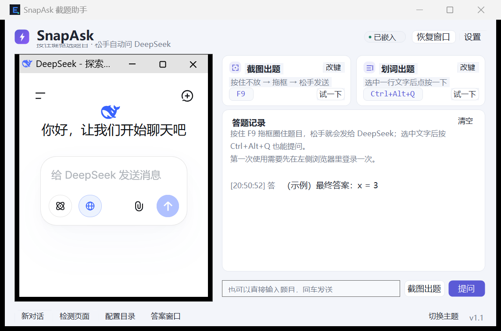
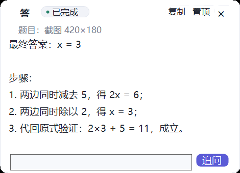

# SnapAsk · 截题秒答

按住键框住屏幕上的题目 → 松手自动发给 **DeepSeek 网页版** → 答案边说边显示在软件里。
选中一行文字按快捷键，也能直接把这行字发过去提问。

> 本项目的 CDP 网页驱动方案复用自 [yrtnb666/EAgentX](https://github.com/yrtnb666/EAgentX)，
> 而 EAgentX 本身基于 [YaoGaoChaoLe/EAgent](https://github.com/YaoGaoChaoLe/EAgent) 重写。
> 派生链：**EAgent → EAgentX → SnapAsk**。详见文末「致谢与出处」。

主界面左边嵌着 DeepSeek 网页（登录、对话都在这一栏里），右边是快捷键、答题记录和输入框。





## 三种用法

| 方式 | 操作 | 默认键 |
|---|---|---|
| 截图出题 | **按住** `Alt` 不放 → 拖框圈住题目 → **松手** | `Alt`（按住） |
| 划词出题 | 用鼠标**选中**一行文字 → 按一下快捷键 | `Ctrl+Alt+Q` |
| 直接输入 | 在右下输入框打字 → 回车 | — |

截图会连同提示词一起发给网页版（提示词可在设置里改），答案卡片会出现在框选区域旁边，可拖动、复制全文、置顶、继续追问。框选时 `Esc` 或**右键**取消。

## 首次使用

1. 双击 `dist\SnapAsk.exe`。
2. 点右上角**嵌入浏览器**，左侧会出现 DeepSeek 登录页，在里面登录一次（之后会记住登录状态）。
3. 也可以直接按住 `Alt` 拖框——程序会自动拉起浏览器、等你登录，然后继续提问。

## 界面说明

- **左侧浏览器**：DeepSeek 网页本体，和独立浏览器完全一样。中间的分隔条可以拖宽拖窄；点「恢复窗口」可以把它放回独立窗口。
- **两张快捷键卡片**：点键位胶囊或「改键」可以重新录键；「试一下」立即触发一次，方便确认手感。
- **答题记录**：每一次提问的题目和答案都留在这里，同时写入 `%APPDATA%\SnapAsk\history\日期.log`。
- **答案卡片**：独立浮窗，支持追问（会接着上一轮对话问）。

## 设置

| 项 | 说明 |
|---|---|
| 截图出题（按住） | 支持单键（Alt / F6…）或组合键（Ctrl+Shift…） |
| 划词出题（点按） | 组合键，如 Ctrl+Alt+Q |
| 引擎 | 网页版（推荐，不需要 Key）/ API 模式（需要 Key，看不了截图） |
| 截图提示词 | 截图后自动附带的问题文本 |
| 划词提示词 | `{text}` 会被替换成选中的文字 |
| 自动弹出结果窗 / 结果窗置顶 | 答案卡片的行为 |
| 连上浏览器后自动嵌入主界面左侧 | 关掉后浏览器保持独立窗口 |
| 深色主题 | 下次启动生效 |
| 回复超时 / 调试端口 / 浏览器路径 | 连接相关，默认即可 |

配置文件：`%APPDATA%\SnapAsk\config.json`，截图暂存：`%APPDATA%\SnapAsk\shots\`。

## 构建与自检

```powershell
cd "D:\新建文件夹 (6)\SnapAsk"
powershell -NoProfile -ExecutionPolicy Bypass -File .\build.ps1

.\dist\SnapAsk.exe --selftest   # 9 项自检（键位解析 / 页面脚本 / 截图链路…）
.\dist\SnapAsk.exe --probe      # 连接体检：浏览器 + CDP + 脚本注入 + 页面状态
.\dist\SnapAsk.exe --uidemo     # 界面自查（示例答案卡 + 嵌入浏览器）
```

源码保持 C# 5，Windows 自带的 C# 编译器和 Roslyn 都能编译，零警告。

## 实现要点

- **网页驱动**沿用 [EAgentX](https://github.com/yrtnb666/EAgentX) 的成熟方案：`EdgeLauncher` 用独立 profile 拉起 Edge/Chrome，
  `CdpClient` 连上标签页后注入 `assets/page_helper.js`，由它写输入框、真实回车、判定「生成中 / 已完成」。
  所以不需要 API Key，登录状态跟着 profile 走。
- **嵌入浏览器**：`SetParent` 把 Edge 窗口塞进左侧面板（去掉 WS_POPUP/CAPTION/THICKFRAME，加 WS_CHILD），
  换父窗口后 Chromium 会异步重排，所以延时校准尺寸；退出时先恢复成独立窗口，避免被一起销毁。
- **框选层**：按下的瞬间先冻结整屏，再在冻结图上画框，截图里不会出现框选层本身。
  长按修饰键会不断发重复 keydown，框选层会忽略修饰键和触发键本身，避免被自己关掉。
- **取词**：独立 STA 线程向当前前台窗口发 Ctrl+C，读剪贴板（会覆盖剪贴板内容）。

## 已知限制

- 网页版的「消息发送过于频繁」是账号级限流，程序会按设置自动等待重发（默认 2 次）。
- API 模式看不了截图（DeepSeek 官方 API 不收图片），截图请用网页版。
- 划词取词走剪贴板，某些禁止复制的 PDF 阅读器取不到文字。
- **最小化时浏览器会暂时放回独立窗口**：嵌入的浏览器随主窗口一起隐藏后，页面会停止渲染，
  回答就抓不回来（小窗卡在「生成中」、内容不同步）。所以最小化时程序会自动把浏览器放回
  独立窗口保持页面活跃，主窗口还原后再自动嵌回来。

## 致谢与出处

- **[yrtnb666/EAgentX](https://github.com/yrtnb666/EAgentX)** —— 本项目的 CDP 网页驱动方案
  （`EdgeLauncher` 拉起独立 profile 的浏览器、`CdpClient` 连接标签页、`assets/page_helper.js`
  注入页面脚本）直接复用自 EAgentX。
- **[YaoGaoChaoLe/EAgent](https://github.com/YaoGaoChaoLe/EAgent)** —— EAgentX 本身基于它重写，
  最初的「CDP 操控 DeepSeek 网页」设计思路与工具协议均源自原作。致原作者 YaoGaoChaoLe。

派生链：**EAgent（易语言，原作）→ EAgentX（C# 重写）→ SnapAsk（截题秒答）**。

## License

本项目沿用 [EAgentX](https://github.com/yrtnb666/EAgentX) 的网页驱动方案，以 **GPL-3.0** 发布，
仅供学习交流，不提供任何担保。完整条款见 [LICENSE](LICENSE)。

同样适用原作的声明：CDP 自动化操控网页**违反了 [DeepSeek 用户协议](https://cdn.deepseek.com/policies/zh-CN/deepseek-terms-of-use.html)**，
请自行评估账号风险。
